<!-- Assets are generated: `python tools/gen_profile.py`. -->

<a href="https://aaronsimpson.com">
  <picture>
    <source media="(prefers-color-scheme: dark)" srcset="assets/hero-dark.svg">
    <source media="(prefers-color-scheme: light)" srcset="assets/hero-light.svg">
    
  </picture>
</a>

  <a href="https://aaronsimpson.com"><b>aaronsimpson.com</b></a> &nbsp;·&nbsp;
  <a href="https://www.linkedin.com/in/aaron-simpson-developer/">LinkedIn</a> &nbsp;·&nbsp;
  <a href="mailto:aaronpimpson@gmail.com">Email</a>

## Desktop

  <a href="https://github.com/AARROWdev/bigfoot"><picture><source media="(prefers-color-scheme: dark)" srcset="assets/card-bigfoot-dark.svg"><source media="(prefers-color-scheme: light)" srcset="assets/card-bigfoot-light.svg"></picture></a>
  <a href="https://github.com/AARROWdev/cratedig"><picture><source media="(prefers-color-scheme: dark)" srcset="assets/card-cratedig-dark.svg"><source media="(prefers-color-scheme: light)" srcset="assets/card-cratedig-light.svg"></picture></a>
  <a href="https://github.com/AARROWdev/play"><picture><source media="(prefers-color-scheme: dark)" srcset="assets/card-play-dark.svg"><source media="(prefers-color-scheme: light)" srcset="assets/card-play-light.svg"></picture></a>

## Android

  <a href="https://github.com/AARROWdev/workout-calendar"><picture><source media="(prefers-color-scheme: dark)" srcset="assets/card-workout-calendar-dark.svg"><source media="(prefers-color-scheme: light)" srcset="assets/card-workout-calendar-light.svg"></picture></a>
  <a href="https://play.google.com/store/apps/details?id=com.sensitivephotofinder.app"><picture><source media="(prefers-color-scheme: dark)" srcset="assets/card-sensitive-pi-dark.svg"><source media="(prefers-color-scheme: light)" srcset="assets/card-sensitive-pi-light.svg"></picture></a>

## Websites

  <a href="https://manifestdnb.com"><picture><source media="(prefers-color-scheme: dark)" srcset="assets/card-websites-dark.svg"><source media="(prefers-color-scheme: light)" srcset="assets/card-websites-light.svg"></picture></a>
  <a href="https://grymlife.com"><picture><source media="(prefers-color-scheme: dark)" srcset="assets/card-grymlife-dark.svg"><source media="(prefers-color-scheme: light)" srcset="assets/card-grymlife-light.svg"></picture></a>

## Stack

**Daily:** Python · PySide6 / Qt 6 · Kotlin · Android · HTML / CSS / JavaScript · PHP · Inno Setup · Playwright 
**AI engineering:** AI coding agents · Claude Code · written specs and per-commit review loops
